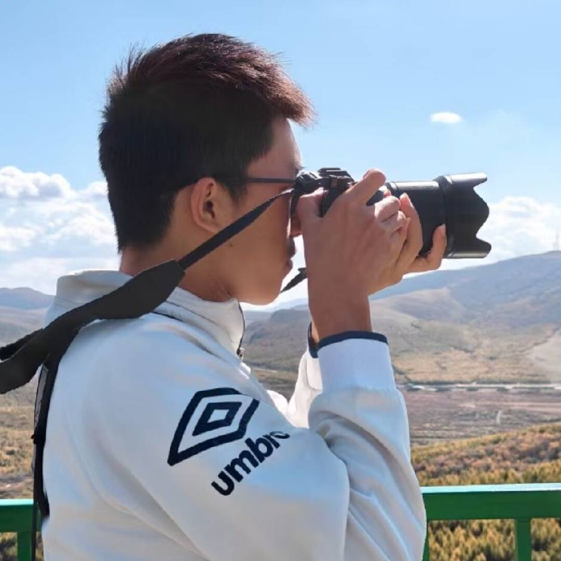

<link rel="stylesheet" href="/assets/css/onepage-home.css?v=20261117-cards-restored">

  <main class="paper">
    

      <button class="lang-btn active" type="button" data-lang="en">EN</button>
      <button class="lang-btn" type="button" data-lang="zh">中文</button>
    

    <section class="hero">
      

        <h1 class="name" translate="no">Yuyang Gao高瑀阳</h1>
        
M.S. Student · School of Computer Science · Peking University

        

          <a class="contact" href="mailto:gaoyuyang26@stu.pku.edu.cn" data-i18n="email">✉ Email</a>
          <a class="contact" href="/assets/CV.pdf" data-i18n="cv">📄 CV</a>
          <a class="contact" href="https://scholar.google.com/citations?user=Pn5C71QAAAAJ&amp;hl=en&amp;oi=sra" target="_blank" rel="noopener" aria-label="Yuyang Gao on Google Scholar">🎓 Google Scholar</a>
          <a class="contact" href="https://github.com/AndyGao6186" target="_blank" rel="noopener">⚙ GitHub</a>
          <a class="contact" href="/images/wechat.png" data-i18n="wechat">💬 WeChat</a>
        

      

      

        
        
♦ ♥ ♠ ♣

      

    </section>

    <section class="intro-box">
      
I am a master's student in Computer Science and Technology at Peking University. My research interests are embodied AI, robot learning, and memory-augmented agents. I study how robots can use physical feedback and past experience to adapt their decisions.

    </section>

    <section class="section">
      <h2 class="section-title">🎓Education</h2>
      

        
2026–Present
<strong>Peking University</strong>, M.S. in Computer Science and Technology, September 2026–present.

        
2022–2026
<strong>Dalian University of Technology</strong>, B.Eng. in Automation, September 2022–June 2026. Undergraduate average: 94.6/100; ranked 1/164.

      

    </section>

    <section class="section">
      <h2 class="section-title">🧪Research</h2>
      

        
♦
<strong>Embodied agents and memory.</strong> Learning from execution feedback and maintaining reusable experience for long-horizon tasks.

        
♠
<strong>Robot learning and manipulation.</strong> Imitation learning, vision-language-action models, and adaptation across tasks.

      

    </section>

    <section class="section" id="publications">
      <h2 class="section-title">📄Publications & Preprints</h2>
      <article class="publication-card">
        <h3><a href="https://arxiv.org/abs/2607.27690" target="_blank" rel="noopener">LabEvolver: Training-Free Experience Evolution for Safe and Grounded Wet-Lab Agents</a></h3>
        
Jingya Wang*, <strong>Yuyang Gao*</strong>, Liuzhenghao Lv, Yonghong Tian, and Yuyang Liu.

        
arXiv preprint, 2026. * Equal contribution.

        
A training-free framework that turns execution trajectories into reusable skill, strategy, and safety memories for closed-loop wet-lab agents.

        
<a href="https://arxiv.org/abs/2607.27690" target="_blank" rel="noopener" data-i18n="paperLabel">Paper</a><a href="https://andygao6186.github.io/LabEvolver/" target="_blank" rel="noopener" data-i18n="projectLabel">Project</a><a href="https://github.com/AndyGao6186/LabEvolver" target="_blank" rel="noopener" data-i18n="repositoryLabel">Repository</a>

      </article>
    </section>

    <section class="section">
      <h2 class="section-title">💼Experience</h2>
      

        

<h3 data-i18n="pkuExpTitle">Peking University · Research Assistant</h3>
Worked with Prof. Yonghong Tian on LabEvolver, integrating multimodal perception, robotic execution, safety validation, and training-free experience evolution for wet-lab agents.

Nov 2025–Jul 2026

        

<h3 data-i18n="thuExpTitle">Tsinghua University · AIR · Research Assistant</h3>
Worked with Prof. Guyue Zhou on mobile and dual-arm manipulation. Combined real and simulated demonstrations to train ACT policies for pick-and-place and hinged-door opening.

Jan–Apr 2025

        

<h3 data-i18n="dlutExpTitle">Dalian University of Technology · Automation</h3>
B.Eng. in Automation; projects in ROS navigation, multi-sensor fusion, embedded systems, and control.

2022–2026

      

    </section>

    <section class="section">
      <h2 class="section-title">🏆Awards</h2>
      

        
2025
National College Student Intelligent Vehicle Competition, ROS Group · <strong>National Second Prize</strong>

        
2025 & 2024
<strong>National Scholarship</strong>

        
2024
National College Student Mathematical Modeling Competition · <strong>National Second Prize</strong>

        
2024
Interdisciplinary Contest in Modeling · <strong>Finalist</strong>

        
2023
<strong>HIWIN Scholarship</strong> · 2 recipients out of 1,138 students

      

    </section>

    <section class="section">
      <h2 class="section-title">🌿Beyond Research</h2>
      
Outside research, I enjoy landscape photography, hiking, playing the saxophone, and building hardware and electronics.

      
<a class="chip" href="https://space.bilibili.com/260882142" target="_blank" rel="noopener">Bilibili</a>PhotographySaxophoneHardware

    </section>

    
Thank you for visiting my homepage.

    
© 2026 Yuyang Gao · Updated November 2026

    
♦ ♥ ♠ ♣

  </main>

